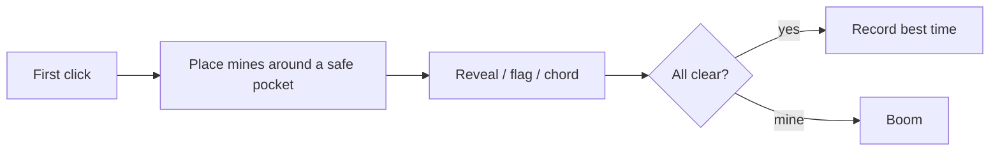

# Field Sweep

Classic Minesweeper in Vue 3 + TypeScript. Beginner, Intermediate, and Expert boards. First click is always safe. Flags, chords, timer, and best times in `localStorage`.

Play: [oscarmmi.github.io/minesweeper](https://oscarmmi.github.io/minesweeper/)

## How to play

Left click opens a cell. Right click or long-press plants a flag. Click a revealed number when its flags match to chord the rest. Clear every non-mine cell to win.



## Run locally

```bash
npm install
npm test
npm run dev
```
